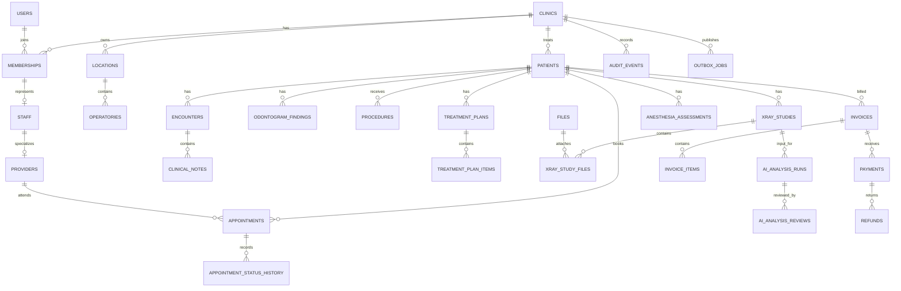

# PostgreSQL schema

Phase 4 introduces a self-hosted PostgreSQL target through `packages/database`. Drizzle provides the
SQL-visible TypeScript model and migration runner; committed SQL in `packages/database/drizzle` remains
the review artifact. The Express API is the future database boundary. The browser is not configured to
connect to PostgreSQL, and existing Supabase-backed features are intentionally unchanged in this phase.

Phase 6 adds reviewed migration `0002_backend_auth.sql` for Better Auth credential accounts, opaque
sessions, hashed reset-token verification storage, persistent rate limits/brute-force counters, and
global append-only security events. `auth_sessions` binds its optional clinic context to the same
membership **and user** through a composite FK. The older `sessions` table is not used for new login.
See [authentication.md](authentication.md) for tenant authorization and operator provisioning.

## Identifier, tenancy, time, and money rules

- Primary identifiers are UUIDs generated with PostgreSQL `gen_random_uuid()`. Imports may retain a
  stable source identifier in migration tooling, but application identifiers are globally unique UUIDs.
- `clinics` is the tenant root. Every tenant-owned child row has a non-null `clinic_id`; global identity
  rows in `users` are deliberately not tenant-owned. A session can be global until a clinic context is
  selected, so `sessions.clinic_id` is nullable.
- Tenant relationships use composite foreign keys such as `(clinic_id, patient_id)` to prevent a row
  from pointing across clinics. Application authorization is still required; row-level-security policy
  design is deferred until authentication migration.
- Instants use `timestamp with time zone`. Appointments and schedule blocks also store the IANA timezone
  used for wall-clock display. Working hours use local `time` plus a location timezone.
- Money is stored as integer minor units (`*_minor`) plus an uppercase three-letter currency. No
  floating-point monetary columns are used.
- Historical scheduling and clinical foreign keys use `ON DELETE RESTRICT`. Cancellation, archival,
  `entered_in_error`, and explicit status transitions replace destructive deletion.

## Domain diagram

The diagram is intentionally domain-level; the table catalog below is authoritative for the complete
schema.



## Table catalog

| Domain                | Tables                                                                                                               | Key history and integrity behavior                                                                                                          |
| --------------------- | -------------------------------------------------------------------------------------------------------------------- | ------------------------------------------------------------------------------------------------------------------------------------------- |
| Clinic                | `clinics`, `clinic_settings`, `locations`, `operatories`, `working_hours`                                            | Valid IANA timezone checks; operatory/location tenant consistency                                                                           |
| Identity              | `users`, `memberships`, `roles`, `membership_roles`, `invitations`, `sessions`                                       | Users are global; roles and membership links are clinic-bound                                                                               |
| People                | `patients`, `staff`, `providers`                                                                                     | Patients are clinical entities; portal identity is optional                                                                                 |
| Scheduling            | `appointment_types`, `appointments`, `appointment_status_history`, `schedule_blocks`                                 | Provider, operatory, and patient exclusion constraints; append-only status events; appointment/block collision triggers                     |
| Clinical              | `encounters`, `clinical_notes`, `medical_alerts`, `allergies`, `medications`                                         | Signed notes are immutable and amendments create versions                                                                                   |
| Dental                | `odontogram_findings`, `odontogram_finding_surfaces`, `procedures`, `procedure_surfaces`, `procedure_status_history` | Tooth and surface codes are explicit; procedure history is append-only                                                                      |
| Planning              | `treatment_plans`, `treatment_plan_items`                                                                            | Plan versions can supersede earlier plans without overwriting history                                                                       |
| Imaging and decisions | `files`, `xray_studies`, `xray_study_files`, `ai_analysis_runs`, `ai_analysis_reviews`, `anesthesia_assessments`     | AI success requires named/versioned model and result artifact; reviews append; finalized anesthesia assessments are immutable and versioned |
| Billing               | `services`, `price_lists`, `price_list_items`, `invoices`, `invoice_items`, `payments`, `refunds`                    | Integer minor units, currency-consistent FKs, non-negative checks, refund cap                                                               |
| Operations            | `audit_events`, `outbox_jobs`                                                                                        | Audit events are append-only; outbox jobs have tenant-scoped idempotency keys                                                               |

## Scheduling collision semantics

Phase 7 adds `clinic_closures` and hashed, short-lived `appointment_slot_offers`, appointment revision/
last-actor columns, bidirectional closure collision checks, delete/transition/history guards, and
database-generated appointment audit events. See [appointments.md](appointments.md). Migration
`0003_backend_scheduling.sql` is additive; no legacy appointment data is deleted or imported.

Intervals use half-open ranges `[starts_at, ends_at)`, allowing one appointment to begin exactly when
another ends. Active appointments reserve their patient, provider, and operatory. `cancelled` and
`no_show` appointments remain in history but release those resources. Schedule blocks reserve a
provider, an operatory, or both and are checked bidirectionally against active appointments. PostgreSQL
exclusion constraints cover same-table concurrency; transaction advisory locks serialize cross-table
appointment/block checks.

## Clinical and decision-support history

- Appointment and procedure status history tables reject updates and deletes.
- Signed clinical notes can only be superseded by a new version; content cannot be overwritten.
- Audit events and clinician AI reviews are append-only.
- Finalized anesthesia assessments cannot be edited or deleted. A later assessment must reference the
  superseded version and preserve its rule-set version.
- `ai_analysis_runs` stores provenance and file references, not invented findings. A successful run
  requires a model name, model version, completion timestamp, and result file; clinical review remains a
  separate record.

## Migration workflow

```bash
npm run infra:up
# Set server-only DATABASE_URL in the shell or root .env; never use a VITE_ prefix.
npm run db:migrate --workspace @dentalai/database
npm run db:seed --workspace @dentalai/database
npm run test:db
```

The development seed uses only clearly fictional names and reserved `.invalid` email addresses. The
database integration test creates a new disposable database, applies every migration from zero, loads
the seed twice to verify idempotency, exercises constraints, and drops the database.

## Explicitly unresolved decisions

1. Confirm the production base currencies and the minor-unit scale for legacy `*_sp` values before any
   billing import; the old schema does not declare a currency or scale.
2. Select the canonical tooth-numbering vocabulary (FDI, Universal, or a normalized code system) before
   production clinical migration.
3. Define patient deduplication, medical-record-number allocation, and optional portal-account linking.
4. Phase 7 skips ambiguous/nonexistent DST slots and offset-crossing durations. Define future
   recurrence expansion and overnight working-hours behavior before extending that policy.
5. Better Auth is selected in Phase 6. Application membership/tenant enforcement is implemented;
   PostgreSQL row-level-security defense-in-depth and a least-privilege deployment DB role still need
   a separate deployment design/review.
6. Set legal retention, correction, archival, and erasure rules per deployment jurisdiction.
7. Decide whether insurance claims, payer adjustments, and split tender need first-class models.
8. Decide whether legacy simulated AI/anesthetic JSON is discarded or retained in a quarantined audit
   archive; it must never be imported as validated output.
9. Confirm whether the deployment role may install `btree_gist`; otherwise provision the extension as
   an infrastructure prerequisite.
