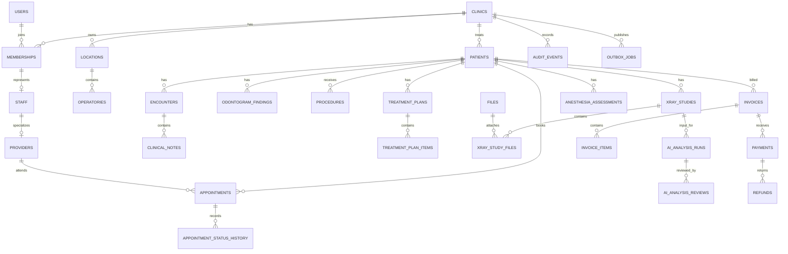

# PostgreSQL schema

Phase 13 adds `clinic_profiles`, `clinic_subscriptions`, append-only `subscription_events`
and `clinic_exports`, `clinic_offboarding`, `notification_preferences` and encrypted
`notification_deliveries`. All have `clinic_id` and tenant foreign keys; `saas_plans` is a
global catalog. Migration 0009 initializes new-clinic trials and preserves existing clinics
with documented administrative grants. SQL capacity triggers and tenant advisory locks
guard seats/locations/appointment creation/storage. See [administration](saas-administration.md).

The server-only schema lives in `packages/database`. Drizzle supplies SQL-visible types and migration
execution; committed reviewed SQL is authoritative. The Express API is the only browser data boundary.
All runtime features now use local PostgreSQL. See [the Phase 12 reset report](phase12-test-data-reset.md)
for synthetic SYP seeding; no legacy source records were imported.

Phase 6 adds reviewed migration `0002_backend_auth.sql` for Better Auth credential accounts, opaque
sessions, hashed reset-token verification storage, persistent rate limits/brute-force counters, and
global append-only security events. `auth_sessions` binds its optional clinic context to the same
membership **and user** through a composite FK. The older `sessions` table is not used for new login.
See [authentication.md](authentication.md) for tenant authorization and operator provisioning.

The independent review adds `0004_review_integrity.sql`: patient identity now participates in
appointment/encounter, encounter/clinical-record and study/analysis foreign keys. It also preserves
appointment creation/cancellation provenance and includes transition reasons in append-only audit.
No clinical feature or inference endpoint is introduced. SQL-only history triggers remain authoritative.

## Deployment and rollback warning

The completed Phase 5–7 commit edited `0000_lovely_tombstone.sql` to create tenant reference keys before
foreign keys. This repairs creation from zero, but an already-applied earlier baseline must not be
assumed equivalent. The runner now serializes migrations and verifies every recorded hash/timestamp
against reviewed files (equivalent LF/CRLF checkouts are accepted). Drift stops deployment; never
blindly replace stored hashes, reset the database, or force a destructive replay.

Before upgrading an existing deployment, make and restore-test an encrypted backup, compare its
applied migration history and schema with the release, and reconcile any drift explicitly. The repair
validates existing patient links and rolls back entirely on inconsistencies; it never deletes or
reassigns clinical data to make constraints pass. Upgrade tests cover the current reviewed Phase 6
baseline with retained signed notes, sessions, appointments and audit, plus failed-repair rollback.
They do not prove compatibility with unknown/manual deployments of the original Phase 4 SQL.

There is no automated destructive down migration. Prefer an additive forward repair; reverting the
application can retain additive constraints only after compatibility testing. Database rollback needs
a separately rehearsed point-in-time/backup restore to a new instance and preservation of writes made
after the backup. Do not claim zero-data-loss rollback without that operational rehearsal.

## Identifier, tenancy, time, and money rules

- Primary identifiers are UUIDs generated with PostgreSQL `gen_random_uuid()`. Imports may retain a
  stable source identifier in migration tooling, but application identifiers are globally unique UUIDs.
- `clinics` is the tenant root. Every tenant-owned child row has a non-null `clinic_id`; global identity
  rows in `users` are deliberately not tenant-owned. A session can be global until a clinic context is
  selected, so `sessions.clinic_id` is nullable.
- Tenant relationships use composite foreign keys such as `(clinic_id, patient_id)` to prevent a row
  from pointing across clinics. Application authorization is still required; row-level-security policy
  design is deferred until authentication migration.
- Instants use `timestamp with time zone`. Appointments and schedule blocks also store the IANA timezone
  used for wall-clock display. Working hours use local `time` plus a location timezone.
- Money is stored as integer minor units (`*_minor`) plus an uppercase three-letter currency. No
  floating-point monetary columns are used.
- Historical scheduling and clinical foreign keys use `ON DELETE RESTRICT`. Cancellation, archival,
  `entered_in_error`, and explicit status transitions replace destructive deletion.

## Domain diagram

The diagram is intentionally domain-level; the table catalog below is authoritative for the complete
schema.



## Table catalog

| Domain                | Tables                                                                                                               | Key history and integrity behavior                                                                                                          |
| --------------------- | -------------------------------------------------------------------------------------------------------------------- | ------------------------------------------------------------------------------------------------------------------------------------------- |
| Clinic                | `clinics`, `clinic_settings`, `locations`, `operatories`, `working_hours`                                            | Valid IANA timezone checks; operatory/location tenant consistency                                                                           |
| Identity              | `users`, `memberships`, `roles`, `membership_roles`, `invitations`, `sessions`                                       | Users are global; roles and membership links are clinic-bound                                                                               |
| People                | `patients`, `staff`, `providers`                                                                                     | Patients are clinical entities; portal identity is optional                                                                                 |
| Scheduling            | `appointment_types`, `appointments`, `appointment_status_history`, `schedule_blocks`                                 | Provider, operatory, and patient exclusion constraints; append-only status events; appointment/block collision triggers                     |
| Clinical              | `encounters`, `clinical_notes`, `medical_alerts`, `allergies`, `medications`                                         | Signed notes are immutable and amendments create versions                                                                                   |
| Dental                | `odontogram_findings`, `odontogram_finding_surfaces`, `procedures`, `procedure_surfaces`, `procedure_status_history` | Tooth and surface codes are explicit; procedure history is append-only                                                                      |
| Planning              | `treatment_plans`, `treatment_plan_items`                                                                            | Plan versions can supersede earlier plans without overwriting history                                                                       |
| Imaging and decisions | `files`, `xray_studies`, `xray_study_files`, `ai_analysis_runs`, `ai_analysis_reviews`, `anesthesia_assessments`     | AI success requires named/versioned model and result artifact; reviews append; finalized anesthesia assessments are immutable and versioned |
| Billing               | `services`, `price_lists`, `price_list_items`, `invoices`, `invoice_items`, `payments`, `refunds`                    | Integer minor units, currency-consistent FKs, non-negative checks, refund cap                                                               |
| Operations            | `audit_events`, `outbox_jobs`                                                                                        | Audit events are append-only; outbox jobs have tenant-scoped idempotency keys                                                               |

## Scheduling collision semantics

Phase 7 adds `clinic_closures` and hashed, short-lived `appointment_slot_offers`, appointment revision/
last-actor columns, bidirectional closure collision checks, delete/transition/history guards, and
database-generated appointment audit events. See [appointments.md](appointments.md). Migration
`0003_backend_scheduling.sql` is additive; no legacy appointment data is deleted or imported.

Intervals use half-open ranges `[starts_at, ends_at)`, allowing one appointment to begin exactly when
another ends. Active appointments reserve their patient, provider, and operatory. `cancelled` and
`no_show` appointments remain in history but release those resources. Schedule blocks reserve a
provider, an operatory, or both and are checked bidirectionally against active appointments. PostgreSQL
exclusion constraints cover same-table concurrency; transaction advisory locks serialize cross-table
appointment/block checks.

## Clinical and decision-support history

- Appointment and procedure status history tables reject updates and deletes.
- Signed clinical notes can only be superseded by a new version; content cannot be overwritten.
- Audit events and clinician AI reviews are append-only.
- Finalized anesthesia assessments cannot be edited or deleted. A later assessment must reference the
  superseded version and preserve its rule-set version.
- `ai_analysis_runs` stores provenance and file references, not invented findings. A successful run
  requires a model name, model version, completion timestamp, and result file; clinical review remains a
  separate record.

## Migration workflow

```bash
npm run infra:up
# Set server-only DATABASE_URL in the shell or root .env; never use a VITE_ prefix.
npm run db:migrate --workspace @dentalai/database
npm run dev:seed # local-only synthetic SYP fixtures; not the historical upgrade fixture
npm run test:db
```

The development seed uses only clearly fictional names and reserved `.invalid` email addresses. The
database integration test creates a new disposable database, applies every migration from zero, loads
the seed twice to verify idempotency, exercises constraints, and drops the database.

## Phase 9 financial ledger

Migration `0006_financial_ledger.sql` adds workflow provenance, immutable price publications,
normalized treatment-plan item links and an append-only ledger, retaining existing tables and
rows. Invoice lines snapshot server prices and descriptions; optional procedure/plan-item links
must belong to the invoice patient and clinic and have clinician approval. New prices are new
publications, never edits to historical price snapshots.

- `billing_invoice_workflows` distinguishes new, reconciled workflow invoices from legacy rows.
  Version advances with every financial event. Draft replacement needs the expected version.
  Draft disposal retains the invoice and audit history. Issuance freezes header and line items.
- `billing_ledger` signs: issuance/debit adjustment/refund increase balance; payment/credit
  adjustment decrease balance. Draft events are zero. Remaining balance is their sum;
  adjusted charges are issuance plus adjustments. Payments and refunds are separate immutable
  source rows. `invoices.balance_minor` is retained legacy storage, **not** the ledger authority.
- Parent invoice row locks serialize concurrent mutations. A transaction writes sources, event,
  workflow version and actor/reason/before/after audit together. Deferred SQL constraints reject
  orphan payments/refunds, unaudited events, unbalanced lines, overpayment, over-refund and
  source changes without matching atomic events. Composite tenant FKs prevent cross-clinic links.
- `request_key` is unique per clinic. Identical retries by the same actor and operation return
  the original receipt; changed details or actor return a conflict. `REC-<UUID>` and `REF-<UUID>`
  reference recorded payments/refunds, not external settlement. No financial delete endpoint exists.
- Integer minor units use an explicit currency. Decimal input respects the currency exponent;
  quantity is integer hundredths. Line extension rounds half-up once using integer arithmetic,
  then subtracts discount and adds explicit tax. Each event/invoice is bounded to 10^12 minor units;
  aggregate reports/payments/refunds permit exact safe integers up to 2^53-1 and fail clearly beyond
  that limit. Reports group currencies without exchange-rate conversion, include issued invoices
  only, and use one database statement/snapshot.

Deploy this additive migration after a verified backup and staging upgrade test. Migration execution
is transactional. There is deliberately no destructive down migration: after new financial events,
dropping ledger/workflow tables would lose provenance. Roll application code forward or restore a
verified backup with operator-approved reconciliation; do not discard recorded money history.
Clean-from-zero and incremental-upgrade tests retain historical rows. Historical Phase 9 implementation did not import or modify hosted source data. Phase 12 uses
an explicitly approved disposable-test-data reset, not a financial migration.

The initial catalog exposes at most 500 patients ordered by name; deployments exceeding this need
explicit pagination/search before operational use. Invoice history is unpaginated. Invoice numbering
is globally unique UUID-based, not jurisdiction-specific sequential legal numbering. Credit notes
are modeled as audited signed adjustments, not certified legal document templates. Multi-clinic
patients are authorized through the selected authenticated membership and explicit portal linkage.

## Explicitly unresolved decisions

1. Confirm the production base currencies and the minor-unit scale for legacy `*_sp` values before any
   billing import; the old schema does not declare a currency or scale.
2. Phase 8 selects FDI two-digit numbering for new clinical records. Legacy numbering and provenance
   still require clinician/operator reconciliation before import; never reinterpret source codes silently.
3. Define patient deduplication, medical-record-number allocation, and optional portal-account linking.
4. Phase 7 skips ambiguous/nonexistent DST slots and offset-crossing durations. Define future
   recurrence expansion and overnight working-hours behavior before extending that policy.
5. Better Auth is selected in Phase 6. Application membership/tenant enforcement is implemented;
   PostgreSQL row-level-security defense-in-depth and a least-privilege deployment DB role still need
   a separate deployment design/review.
6. Set legal retention, correction, archival, and erasure rules per deployment jurisdiction.
7. Decide whether insurance claims, payer adjustments, and split tender need first-class models.
8. Decide whether legacy simulated AI/anesthetic JSON is discarded or retained in a quarantined audit
   archive; it must never be imported as validated output.
9. Confirm whether the deployment role may install `btree_gist`; otherwise provision the extension as
   an infrastructure prerequisite.
